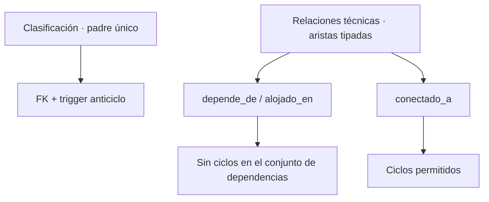

# Ingeniería asistida por IA

Registro seleccionado del trabajo del 28–29/10/2026. Herramienta disponible: asistente Codex en ChatGPT con archivos, terminal y pruebas locales. No se registra una versión comercial del modelo por prompt porque no existe evidencia verificable de ella. La aplicación no requiere IA ni suscripción para ejecutarse.

## Prompt Engineering

Se distinguen los mensajes del usuario de las consignas operativas registradas por el asistente. No se presenta un documento redactado después como si fuera la exportación íntegra de una conversación anterior.

### Ocho consignas operativas registradas

La [copia del registro previo](evidencias/registro-operativo-previo.md) contiene las ocho consignas que cubren las áreas solicitadas. La tabla organiza su objetivo, contexto, restricción y aceptación; no atribuye ocho mensajes literales al usuario. Fecha registrada: ampliación del 28/10/2026; herramienta: Codex, terminal y archivos locales. Cambios asociados: [597dc46](evidencias/commits/597dc46.patch) y [b12906a](evidencias/commits/b12906a.patch).

| ID / área | Consigna registrada y objetivo | Contexto y restricciones | Salida esperada / aceptación |
|---|---|---|---|
| R1 Requisitos | Contrastar funciones con SA_P3 y conservar controles del parcial. | Enunciado, proyecto y catálogo; no borrar datos ni inventar resultados. | Matriz P01–P18; suites del parcial conservadas. |
| R2 CMDB | Identificar campos, celdas y diferencias reales de fuentes. | CMDB B4:U6, presentaciones; no atribuir una taxonomía inventada al docente. | Mapeo de veinte campos, originales preservados y limitación declarada. |
| R3 Modelo | Revisar claves y derivaciones para evitar contradicciones. | SQL 001–003; compatibilidad con datos existentes. | Relaciones y migración aditiva; empresa/N1/tipo derivados. |
| R4 Colas | Comprobar permisos y toma atómica. | Rol base, usuario_rol y cola_permiso; consulta no se eleva por pertenencia. | 403 al no autorizado; toma simultánea 201/409. |
| R5 Procesos | Recorrer siete flujos y rechazar saltos/autoaprobación. | FLOWS y detalle de proceso; aprobación en servidor. | Rutas completas y rechazos P09/P10. |
| R6 Seguridad | Revisar notas, adjuntos y campos reservados. | Sesiones y HTTP; descargar solo con autorización. | Rechazo de aprobación manipulada y adjunto interno al solicitante. |
| R7 Grafos | Revisar ciclos y dependencias sin confundirlas con interrupciones. | ci_clase, ci_relacion y servicios; conectividad puede tener ciclos. | Clasificación acíclica, recorrido terminante y aviso de impacto potencial. |
| R8 Pruebas | Compilar y ejecutar comprobaciones aisladas conservando fallos. | Fuentes y entorno sin Docker; no sustituir P18 con PGlite. | Logs y códigos de salida; diferencias de entorno documentadas. |

Límite de procedencia: existe este registro operativo en la documentación previa, pero no una exportación independiente de cada llamada histórica. No se certifica que sean ocho intercambios textuales distintos. Las siguientes selecciones sí proceden de mensajes visibles del chat y explican correcciones concretas.

### Selección de instrucciones reales del chat

Se conserva la ortografía de los fragmentos; el objetivo y el criterio de aceptación son anotaciones documentales. La fecha individual de cada mensaje no se inventa: se registra el intervalo de trabajo 28–29/10 y la secuencia conversacional.

| ID | Fragmento literal | Objetivo, contexto y restricción | Resultado esperado / criterio |
|---|---|---|---|
| U1 | «ahora solo analiza lo que hay que realizar y dime cuales son las funcionalidades nuevas y como es que interactuaran con el sistema actual.» | Analizar requisitos antes de implementar; conservar la base. | Separar ampliación de catálogo y organización previos. |
| U2 | «que deveria de mostrar de mejor manera CMDB?» | Precisar la ficha CMDB con fuentes aportadas. | Atributos, clasificación, relaciones, servicios e historial distinguibles. |
| U3 | «Bueno entonces ayudame a realizar completar el proyecto» | Implementar alcance autorizado y entregar guía; usar fuentes originales. | Código, migraciones, datos, pruebas y reproducción. |
| U4 | «Mira si puedes ver estoy entrando como solicitante y puedo ver información que no le corresponde verdad?» | Revisar exposición observada; rol solicitante con base consulta. | Restricciones efectivas en API, no solo ocultar botones. |
| U5 | «dame un git patch con ese cambio crear un segundo solicitante» | Probar separación de identidades e integrar formularios en panel. | solicitante2 y pruebas de aislamiento; parche incremental. |
| U6 | «ya pude ingresar pero no me esta saliendo la informacion de CI afectados» | Diagnosticar selector vacío sin abrir el inventario global. | Explicar asignación del responsable y mantener selector mínimo. |
| U7 | «cada vez que recargo la pagina se cierra la sesión osea se borra la sesión» | Corregir pérdida por estado en memoria; respetar autenticación. | Restaurar credencial vigente validando /auth/me y revocar al salir. |
| U8 | «quiero que halla secciones en esta parte» | Reducir recorrido vertical de la ficha; conservar permisos y campos. | Secciones, toma accesible, responsable visible y pruebas DOM. |

### Dos mejoras comprobadas de la instrucción

| Caso | Planteamiento inicial y problema | Refinamiento aplicado | Resultado y evidencia |
|---|---|---|---|
| Aislamiento | El primer alcance de Service Desk no detallaba suficientemente la exposición de consulta base frente a solicitante. El usuario observó módulos y datos internos. | Exigir casos propios incluso con permisos accidentales de cola, bloquear módulos directos y agregar otra identidad de prueba. | [d682e9c](evidencias/commits/d682e9c.patch); tests portal y [Service Desk actual](evidencias/service-desk.txt). |
| Sesión y ficha | El panel lateral evitó formularios al pie del listado, pero conservó una ficha larga; la sesión vivía solo en memoria. | U7/U8 precisan recarga y secciones: token temporal por pestaña, validación de servidor, Atención inicial para agente y conservación de campos al cambiar de sección. | [6fdfabf](evidencias/commits/6fdfabf.patch); [nueve tests frontend](evidencias/frontend.txt), [build](evidencias/build-frontend.txt) y [captura con secciones](evidencias/05-secciones-implementadas.png). |

El refinamiento se basa en fallos y capturas reales; no en una aprobación docente supuesta.

## Context Engineering

AGENTS.md fija modelo, importación, seguridad, comandos y límites. Se duplica en [evidencia](evidencias/codigo/AGENTS.md). Fuentes externas son datos: los textos de Excel/PDF no sustituyen las instrucciones del proyecto. Se conservan sus bytes y hashes en [fuentes](../fuentes/SHA256.txt).

| Fase | Contexto proporcionado | Actualización justificada | Commit verificable |
|---|---|---|---|
| Base preservada | Proyecto del parcial, enunciado y reglas del importador. | Mantener organización, bajas, 12/46 y asignaciones. | Historial base en [COMMITS](evidencias/COMMITS.txt). |
| Ampliación | SA_P3, modelo previo y restricciones de roles. | [005_service_desk.md](contexto/005_service_desk.md): nuevos módulos sin perder compatibilidad. | [f189e93](evidencias/commits/f189e93.patch) |
| Fuentes CMDB | Excel y presentaciones con localización de campos. | [006_fuentes_cmdb.md](contexto/006_fuentes_cmdb.md): distinguir fuente real y clasificación propuesta. | [597dc46](evidencias/commits/597dc46.patch) |
| Pruebas | Fallos del seed, rutas y comportamiento temporal. | [007_pruebas_y_relojes.md](contexto/007_pruebas_y_relojes.md): corregir datos/tipos, concurrencia y relojes. | [b12906a](evidencias/commits/b12906a.patch) |
| Seguridad | Captura de solicitante y necesidad de segunda identidad. | [008_portal_solicitantes.md](contexto/008_portal_solicitantes.md): política de portal y panel lateral. | [d682e9c](evidencias/commits/d682e9c.patch) |
| Experiencia de uso | Recarga con pérdida de sesión y capturas de ficha larga. | [009_sesion_y_secciones.md](contexto/009_sesion_y_secciones.md): persistencia temporal y navegación. | [6fdfabf](evidencias/commits/6fdfabf.patch) |

Glosario usado: CI = elemento de configuración; CMDB = base de configuración; CMS = sistema de gestión de configuración; SKMS = sistema de conocimiento; cola = grupo de distribución con proceso y permisos; N1/N2 = niveles del catálogo; nivel de soporte = capacidad de atención, distinto de N1/N2; tipo = clase de ticket; proceso = flujo operativo; rol = facultad funcional; permiso = operación autorizada en una cola.

## Harness Engineering

El harness combina preparación, datos, automatización y criterios de salida. Docker proporciona el entorno; por sí solo no constituye la verificación.

| Operación | Automatización / comando | Resultado observable |
|---|---|---|
| Configurar | scripts/configure.mjs | .env local creado con secretos aleatorios; no sobrescribe uno existente. |
| Preparar | scripts/prepare.ps1 o prepare.sh | Cada paso con salida 0; se detiene ante error. |
| Migrar | npm run migrate en backend | Versiones SQL aplicadas sin synchronize. |
| Importar | npm run import:excel | Resumen creado/actualizado/omitido/observado y controles 12/46. |
| Sembrar referencias | seed:demo y seed:asignaciones | Cuentas, organización y tres asignaciones válidas. |
| Cargar CMDB/tickets | seed:desk o generate:cmdb | Semilla, conjunto, cantidad generada y distribución. |
| Verificar backend | test:embedded y test:desk | Tests Node con NestJS/HTTP y DB PGlite aislada; fallo devuelve código no cero. |
| Verificar frontend | npm test y npm run build | Casos de sesión y DOM simulado; salida de build estático. |
| Verificar despliegue | test:harness contra Compose | Resultado live; pendiente de ejecución registrada en este entorno. |
| Verificar persistencia | check-persistence-desk.ps1/sh | Comparación de hashes antes/después del reinicio sin eliminar volumen; pendiente aquí. |

[Scripts copiados](evidencias/codigo/scripts/prepare.ps1), [Docker backend](evidencias/codigo/backend/Dockerfile), [Docker frontend](evidencias/codigo/frontend/Dockerfile), [tests backend](evidencias/codigo/backend/tests/desk.test.cjs) y [tests UI](evidencias/codigo/frontend/tests/ui-cases.jsx).

Los fixtures aislados no alteran el conjunto de evaluación. No se publican secretos reales ni .env de trabajo; las credenciales documentadas son DEMO. El perfil verificaciones conserva dependencias de prueba y no usa red. Las descargas de adjuntos y los permisos se prueban con casos negativos. El resultado del generador no se confunde con el conteo de relaciones o catálogos.

## Loop Engineering

Se registran cinco ciclos con evidencias. Ningún fallo de estos ciclos fue introducido deliberadamente. La intervención humana consistió en aportar fuentes, autorizar el alcance y reportar comportamientos observados; no se atribuyen al docente aprobaciones que no constan.

| Ciclo | Objetivo → cambio → ejecución | Evaluación → corrección → nueva verificación | Salida y evidencia |
|---|---|---|---|
| L1 Datos | Sembrar 5000 CI y cuentas; ejecutar test:desk intento 1. | Fallo SQL por $2 usado con TEXT/VARCHAR. Se aplicaron casts y ajustes del seed; el intento 2 superó este fallo y encontró otro. | Intentos [1](evidencias/historicas/desk-intento-1.txt), [2](evidencias/historicas/desk-intento-2.txt) y [3](evidencias/historicas/desk-intento-3.txt); cambio [b12906a](evidencias/commits/b12906a.patch). Salida: repetir la carga sin duplicar 5000. |
| L2 Funcional | Recorrer los siete procesos con datos demo; ejecutar intento 2. | Servicios falló al entrar a validacion por resultado_validacion ausente. Se agregó la evidencia demo y el campo correspondiente; intento 3 y regresión comprobaron las rutas. | [Intento 2 fallido](evidencias/historicas/desk-intento-2.txt), [intento 3](evidencias/historicas/desk-intento-3.txt) y P09/P10 en [suite actual](evidencias/service-desk.txt). Salida: siete rutas completas y saltos rechazados. |
| L3 Permisos | Usuario reportó lectura impropia como solicitante. Se añadió política de portal, segundo solicitante y tests negativos HTTP. | Se comprobó que ocultar botones era insuficiente; se filtraron tickets, bootstrap, CI y snapshots y se cerraron endpoints internos. | [d682e9c](evidencias/commits/d682e9c.patch), [portal-seguridad](evidencias/historicas/portal-seguridad.txt), tres grupos portal en suite actual. Salida: casos ajenos/módulos internos 403, vista propia mínima. |
| L4 Sesión/interfaz | Usuario reportó pérdida al recargar y exceso de desplazamiento. Se implementó sesión temporal validada y ficha por secciones. | Se verificaron recarga, expiración, logout, fallos de conexión y navegación conservando campos; se ajustó el scroll para mantener cabecera y navegación. | [6fdfabf](evidencias/commits/6fdfabf.patch), [frontend actual](evidencias/frontend.txt) y [captura](evidencias/05-secciones-implementadas.png). Salida: nueve pruebas y build correctos; inspección visual exhaustiva pendiente. |
| L5 Build | Compilar la interfaz completa con Vite/React. | Bloqueo observado en transforming; transformación aislada esbuild sí completó. Se retiró Babel redundante y se desactivó tree shaking. | [Diagnóstico](evidencias/historicas/frontend-diagnostico.txt), [esbuild](evidencias/historicas/build-frontend-esbuild.txt), [build histórico](evidencias/historicas/build-frontend-final.txt) y [actual](evidencias/build-frontend.txt). Salida: artefacto estático generado; no se asegura una causa interna del optimizador no demostrada. |

Límites de iteración: el registro histórico fijó tres intentos dirigidos de diagnóstico; se conservan los tres del seed. No se inventa el número de intentos internos de los otros casos. Para reproducirlos, se establece detenerse tras tres intentos sin progreso, conservar logs y requerir revisión humana; nunca forzar permisos, borrar volúmenes o declarar éxito sin nueva prueba. El criterio técnico de cierre es que pase la prueba del defecto y la regresión pertinente.

### Validación humana del escalamiento

La selección de destino fue confundida con una operación guardada. Se revisaron código, captura y bitácora: seleccionar no cambia la cola; Asignar no escala; Escalar exige motivo. Después de la explicación, el usuario aportó [captura de Nivel 2/agente2](evidencias/08-escalamiento-reflejado.png). Se documenta como corrección de uso validada visualmente, no como defecto del backend ni como prueba de cierre del incidente.

## Grafos

Clasificación y relaciones técnicas son grafos distintos. La clasificación tiene padre único, FK y trigger anticiclo. Hardware/Software tienen origen en Excel; las subclases adicionales son propuesta declarada. La jerarquía organizacional no sustituye la CMDB.



En relaciones técnicas, «A depende de B» significa que A puede verse afectado por B; se recorre en sentido inverso desde B para encontrar dependientes. SQL recursivo con UNION evita revisitas. Los servicios vinculados a esos CI se muestran como potencialmente afectados; no se afirma una interrupción efectiva. [P14](evidencias/service-desk.txt) verifica A depende B, rechaza B alojado A y permite una conexión. Las reglas están en [desk.service.ts](evidencias/codigo/backend/src/desk/desk.service.ts) y [migración 003](evidencias/codigo/db/migrations/003_service_desk.sql).

## Enlace a commits y reproducibilidad

[COMMITS.txt](evidencias/COMMITS.txt) contiene hashes completos; los enlaces anteriores abren los diffs de esos commits. El [bundle local](evidencias/historial.bundle) permite recuperarlos sin un remoto:

```bash
git clone doc_p3/docs/evidencias/historial.bundle ../p3-historial
git -C ../p3-historial show d682e9c
git -C ../p3-historial show 6fdfabf
```

Comandos desde la raíz del repositorio que contiene doc_p3. El bundle conserva el historial de construcción hasta el corte de código, no una publicación ni un commit del repositorio del estudiante. Esta carpeta documental se entrega después de ese corte; la identidad final de la entrega debe corresponder al commit que el estudiante publique con sus cambios.
