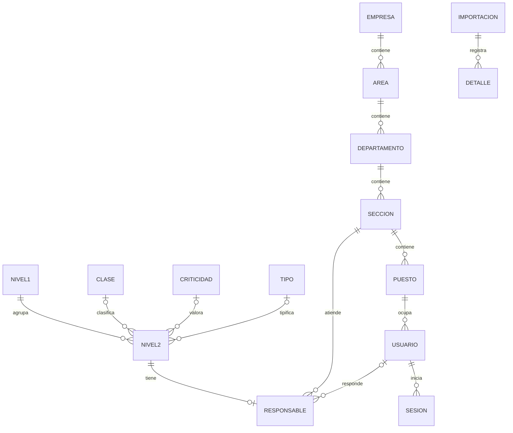
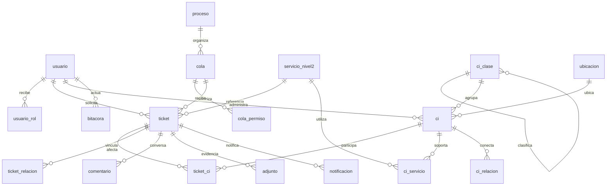
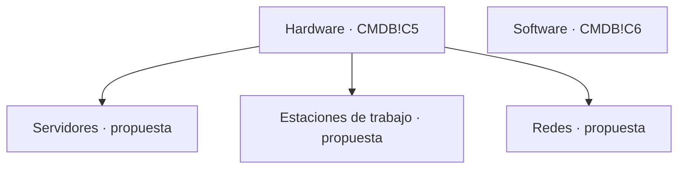

# Modelo y diccionario PostgreSQL / TypeORM

Entidades: `backend/src/db/entities.ts`. DDL base: migraciones 001 y 002; ampliación: 003_service_desk.sql; nunca synchronize.
Esquema `catalogo`. PK BIGINT identity se expone como texto; los campos NUMERIC también,
para evitar pérdida de precisión en JavaScript. `NULL` significa información ausente.
FK siempre RESTRICT, sin borrado en cascada.

## Empresa (`empresa`)

| Campo  | Tipo                   | Llave  | Obligatorio / nulo    |
| ------ | ---------------------- | ------ | --------------------- |
| id     | BIGINT IDENTITY ALWAYS | PK     | Obligatorio, generado |
| codigo | VARCHAR(50)            | UNIQUE | Obligatorio           |
| nombre | TEXT                   | —      | Obligatorio           |
| activo | BOOLEAN                | —      | Obligatorio           |

## Área (`area`)

| Campo      | Tipo                   | Llave                     | Obligatorio / nulo    |
| ---------- | ---------------------- | ------------------------- | --------------------- |
| id         | BIGINT IDENTITY ALWAYS | PK                        | Obligatorio, generado |
| empresa_id | BIGINT                 | FK empresa.id             | Obligatorio           |
| codigo     | VARCHAR(50)            | UNIQUE(empresa_id,codigo) | Obligatorio           |
| nombre     | TEXT                   | —                         | Obligatorio           |
| activo     | BOOLEAN                | —                         | Obligatorio           |

## Departamento (`departamento`)

| Campo   | Tipo                   | Llave                  | Obligatorio / nulo    |
| ------- | ---------------------- | ---------------------- | --------------------- |
| id      | BIGINT IDENTITY ALWAYS | PK                     | Obligatorio, generado |
| area_id | BIGINT                 | FK area.id             | Obligatorio           |
| codigo  | VARCHAR(50)            | UNIQUE(area_id,codigo) | Obligatorio           |
| nombre  | TEXT                   | —                      | Obligatorio           |
| activo  | BOOLEAN                | —                      | Obligatorio           |

## Sección (`seccion`)

| Campo           | Tipo                   | Llave                          | Obligatorio / nulo    |
| --------------- | ---------------------- | ------------------------------ | --------------------- |
| id              | BIGINT IDENTITY ALWAYS | PK                             | Obligatorio, generado |
| departamento_id | BIGINT                 | FK departamento.id             | Obligatorio           |
| codigo          | VARCHAR(50)            | UNIQUE(departamento_id,codigo) | Obligatorio           |
| nombre          | TEXT                   | —                              | Obligatorio           |
| activo          | BOOLEAN                | —                              | Obligatorio           |

## Puesto (`puesto`)

| Campo      | Tipo                   | Llave                     | Obligatorio / nulo    |
| ---------- | ---------------------- | ------------------------- | --------------------- |
| id         | BIGINT IDENTITY ALWAYS | PK                        | Obligatorio, generado |
| seccion_id | BIGINT                 | FK seccion.id             | Obligatorio           |
| codigo     | VARCHAR(50)            | UNIQUE(seccion_id,codigo) | Obligatorio           |
| nombre     | TEXT                   | —                         | Obligatorio           |
| activo     | BOOLEAN                | —                         | Obligatorio           |

## Usuario (`usuario`)

| Campo          | Tipo                   | Llave                          | Obligatorio / nulo        |
| -------------- | ---------------------- | ------------------------------ | ------------------------- |
| id             | BIGINT IDENTITY ALWAYS | PK                             | Obligatorio, generado     |
| puesto_id      | BIGINT                 | FK puesto.id                   | Obligatorio               |
| nombre         | TEXT                   | —                              | Obligatorio               |
| nombre_usuario | VARCHAR(100)           | UNIQUE lower(nombre_usuario)   | Obligatorio               |
| correo         | TEXT                   | UNIQUE lower(correo), parcial  | Nulo permitido            |
| password_hash  | TEXT                   | —                              | Obligatorio; select:false |
| rol            | VARCHAR(20)            | CHECK administrador / consulta | Obligatorio               |
| activo         | BOOLEAN                | —                              | Obligatorio               |

Usuario/correo se normalizan a minúsculas. La empresa se obtiene mediante su puesto y
jerarquía; no hay una segunda FK empresa_id que permita contradicciones.

## Clase (`clase_servicio`)

| Campo  | Tipo                   | Llave  | Obligatorio / nulo    |
| ------ | ---------------------- | ------ | --------------------- |
| id     | BIGINT IDENTITY ALWAYS | PK     | Obligatorio, generado |
| nombre | TEXT                   | UNIQUE | Obligatorio           |
| activo | BOOLEAN                | —      | Obligatorio           |

## Criticidad (`criticidad`)

| Campo  | Tipo                   | Llave  | Obligatorio / nulo    |
| ------ | ---------------------- | ------ | --------------------- |
| id     | BIGINT IDENTITY ALWAYS | PK     | Obligatorio, generado |
| nombre | TEXT                   | UNIQUE | Obligatorio           |
| activo | BOOLEAN                | —      | Obligatorio           |

## Tipo (`tipo_servicio`)

| Campo  | Tipo                   | Llave  | Obligatorio / nulo    |
| ------ | ---------------------- | ------ | --------------------- |
| id     | BIGINT IDENTITY ALWAYS | PK     | Obligatorio, generado |
| nombre | TEXT                   | UNIQUE | Obligatorio           |
| activo | BOOLEAN                | —      | Obligatorio           |

El estado de opciones es disponibilidad administrativa explícita. No se hereda de ACTIVO
ni se asigna como estado a servicios. Una opción inactiva sigue visible en registros históricos;
no se permiten asociaciones nuevas con ella.

## Servicio Nivel 1 (`servicio_nivel1`)

| Campo             | Tipo                   | Llave  | Obligatorio / nulo    |
| ----------------- | ---------------------- | ------ | --------------------- |
| id                | BIGINT IDENTITY ALWAYS | PK     | Obligatorio, generado |
| codigo            | VARCHAR(20)            | UNIQUE | Obligatorio           |
| nombre            | TEXT                   | —      | Obligatorio           |
| activo            | BOOLEAN                | —      | Nulo permitido        |
| requiere_revision | BOOLEAN                | —      | Obligatorio           |

## Servicio Nivel 2 (`servicio_nivel2`)

| Campo             | Tipo                   | Llave                  | Obligatorio / nulo    |
| ----------------- | ---------------------- | ---------------------- | --------------------- |
| id                | BIGINT IDENTITY ALWAYS | PK                     | Obligatorio, generado |
| nivel1_id         | BIGINT                 | FK servicio_nivel1.id  | Obligatorio           |
| codigo            | VARCHAR(20)            | UNIQUE                 | Obligatorio           |
| nombre            | TEXT                   | —                      | Obligatorio           |
| activo            | BOOLEAN                | —                      | Nulo permitido        |
| clase_id          | BIGINT                 | FK clase_servicio.id   | Nulo permitido        |
| criticidad_id     | BIGINT                 | FK criticidad.id       | Nulo permitido        |
| tipo_id           | BIGINT                 | FK tipo_servicio.id    | Nulo permitido        |
| descripcion       | TEXT                   | —                      | Nulo permitido        |
| metrica           | TEXT                   | —                      | Nulo permitido        |
| minimo            | NUMERIC                | CHECK umbrales_validos | Nulo permitido        |
| maximo            | NUMERIC                | CHECK umbrales_validos | Nulo permitido        |
| requiere_revision | BOOLEAN                | —                      | Obligatorio           |

CHECK: `minimo IS NULL OR maximo IS NULL OR minimo <= maximo`, también validado en DTO
y servicio al combinar PATCH. No usar parseFloat ni `valor || 0`.
ACTIVO pertenece a N2, nunca se propaga automáticamente a N1. Padre N1 explícitamente
inactivo no permite nuevas asociaciones ni reactivar hijos mediante el CRUD.

## Responsabilidad (`servicio_responsable`)

| Campo              | Tipo   | Llave                      | Obligatorio / nulo |
| ------------------ | ------ | -------------------------- | ------------------ |
| servicio_nivel2_id | BIGINT | PK / FK servicio_nivel2.id | Obligatorio        |
| seccion_id         | BIGINT | FK seccion.id              | Obligatorio        |
| usuario_id         | BIGINT | FK usuario.id              | Nulo permitido     |

Cero o una asignación por servicio. Sección obligatoria en cada asignación; usuario de la misma
sección, activo. Un POST manual de N2 requiere sección y crea ambas filas en una transacción.
Excepción del enunciado: un servicio importado puede carecer de asignación; no se inventa.

## Sesión (`sesion`)

| Campo       | Tipo        | Llave                       | Obligatorio / nulo |
| ----------- | ----------- | --------------------------- | ------------------ |
| id          | UUID        | PK; jti del JWT             | Obligatorio        |
| usuario_id  | BIGINT      | FK usuario.id               | Obligatorio        |
| creada_en   | TIMESTAMPTZ | DEFAULT now()               | Obligatorio        |
| expira_en   | TIMESTAMPTZ | CHECK expira_en > creada_en | Obligatorio        |
| revocada_en | TIMESTAMPTZ | —                           | Nulo permitido     |

## Lote de importación (`importacion`)

| Campo          | Tipo                   | Llave         | Obligatorio / nulo    |
| -------------- | ---------------------- | ------------- | --------------------- |
| id             | BIGINT IDENTITY ALWAYS | PK            | Obligatorio, generado |
| archivo_nombre | TEXT                   | —             | Obligatorio           |
| archivo_sha256 | CHAR(64)               | —             | Obligatorio           |
| fecha          | TIMESTAMPTZ            | DEFAULT now() | Obligatorio           |
| version_reglas | VARCHAR(50)            | —             | Obligatorio           |
| estado         | VARCHAR(20)            | —             | Obligatorio           |
| resumen        | JSONB                  | —             | Obligatorio           |

## Detalle de importación (`importacion_detalle`)

| Campo            | Tipo                   | Llave                 | Obligatorio / nulo    |
| ---------------- | ---------------------- | --------------------- | --------------------- |
| id               | BIGINT IDENTITY ALWAYS | PK                    | Obligatorio, generado |
| importacion_id   | BIGINT                 | FK importacion.id     | Obligatorio           |
| hoja             | TEXT                   | —                     | Obligatorio           |
| fila             | INTEGER                | CHECK >0              | Obligatorio           |
| nivel1_id        | BIGINT                 | FK servicio_nivel1.id | Nulo permitido        |
| nivel2_id        | BIGINT                 | FK servicio_nivel2.id | Nulo permitido        |
| datos_originales | JSONB                  | —                     | Obligatorio           |
| datos_resueltos  | JSONB                  | —                     | Obligatorio           |
| origen_celdas    | JSONB                  | —                     | Obligatorio           |
| resultado        | VARCHAR(20)            | —                     | Obligatorio           |
| observaciones    | JSONB                  | —                     | Obligatorio           |

Celda subordinada de combinación: original NULL y referencia al master; resuelto contiene
el valor de su master. No se confunde ese original con un valor realmente vacío del master.
El binario original y su SHA permiten reconstruir cualquier evidencia.

## Proyección importada (`importacion_snapshot`)

| Campo               | Tipo        | Llave                             | Obligatorio / nulo |
| ------------------- | ----------- | --------------------------------- | ------------------ |
| entidad             | VARCHAR(20) | PK compuesto; CHECK nivel1/nivel2 | Obligatorio        |
| codigo              | VARCHAR(20) | PK compuesto                      | Obligatorio        |
| payload             | JSONB       | Última proyección importada       | Obligatorio        |
| editado_manualmente | BOOLEAN     | DEFAULT false                     | Obligatorio        |

No representa una segunda identidad del servicio. Controla reconciliación por código y
no contiene responsables. Los códigos importados no se cambian por CRUD.

## Marca de migración (`schema_migration`)

| Campo       | Tipo        | Llave         | Obligatorio / nulo |
| ----------- | ----------- | ------------- | ------------------ |
| version     | TEXT        | PK            | Obligatorio        |
| aplicado_en | TIMESTAMPTZ | DEFAULT now() | Obligatorio        |

## Política de integridad

Bajas lógicas; bloquear unidades con descendientes activos o asignaciones; bloquear traslado
de usuarios/puestos que invalide su sección responsable; bloquear baja de N1 con hijos activos.
El CRUD y las cargas se serializan con bloqueo asesor transaccional. Los triggers y las FK
refuerzan las reglas para accesos SQL. La base no exige asignación a todos los N2 por la
excepción de importación; esa obligatoriedad del alta manual se valida en la API.

## Mapeo de etiquetas (`opcion_mapeo`)

| Campo         | Tipo        | Llave                                         | Obligatorio / nulo              |
| ------------- | ----------- | --------------------------------------------- | ------------------------------- |
| entidad       | VARCHAR(20) | PK compuesto; CHECK clases/criticidades/tipos | Obligatorio                     |
| nombre_origen | TEXT        | PK compuesto                                  | Obligatorio                     |
| clase_id      | BIGINT      | FK clase_servicio.id                          | Nulo salvo entidad=clases       |
| criticidad_id | BIGINT      | FK criticidad.id                              | Nulo salvo entidad=criticidades |
| tipo_id       | BIGINT      | FK tipo_servicio.id                           | Nulo salvo entidad=tipos        |
| fecha         | TIMESTAMPTZ | DEFAULT now()                                 | Obligatorio                     |

CHECK: exactamente una FK no nula, correspondiente a entidad. Al renombrar opciones se
conserva el nombre anterior, con fecha y referencia a la identidad actual. No se sobreescribe
el Excel. El importador reconoce ese alias, preserva IDs y reporta el mapeo. Un alias queda
reservado para su identidad y no se reutiliza para otra. Lectura administrativa en catalog/mapeos.

# Ampliación: tickets, CMDB y fuentes

## Diccionario de tablas nuevas

| Tabla | Datos principales / restricciones |
|---|---|
| usuario_rol | PK usuario+rol. Roles adicionales; el rol base sigue en usuario. |
| proceso | Siete códigos controlados, nombre y tipo de ticket. |
| cola | Código único, descripción, activo, FK proceso y responsable, nivel 0–4, orden, objetivos positivos en minutos. |
| cola_permiso | FK cola y usuario o rol, nunca ambos; array de permisos enumerados. |
| ubicacion | Nombre único, estado. Baja protegida desde API ante CI activos. |
| ci_clase | Código único, nombre, padre opcional, estado y origen. FK y trigger anticiclo. |
| ci | Código único, nombre, clasificación, estado lógico/operativo, ubicación, responsable, es_dispositivo, atributos JSONB, fuente JSONB, conjunto sintético, actualización. |
| ci_relacion | PK origen+destino+tipo. Prohíbe autoarista. Tipos: depende_de/alojado_en/conectado_a. |
| ci_servicio | PK CI+N2. Relación muchos a muchos. |
| ticket | Título, descripción, solicitante, creador, servicio, cola, responsable opcional, estado, prioridad 1–3, impacto, urgencia, canal, motivo sin CI, detalle por proceso, resolución, fechas, pausas, evento origen único, clave externa única y clave demo única. |
| ticket_ci | PK ticket+CI. Sin filas exige motivo en ticket. |
| ticket_relacion | Origen+destino+tipo; relacionado/causa/corrige/duplicado/origina. |
| bitacora | Entidad, registro, actor, fecha, acción, anterior/nuevo JSONB y motivo. Trigger rechaza UPDATE/DELETE. |
| comentario | Ticket, actor, texto, interno, fecha. Notas internas protegidas. |
| adjunto | Ticket, actor, nombre, MIME, bytes ≤2 MiB, interno, fecha. Se almacena en DB, no ruta pública. |
| notificacion | Ticket, mensaje, fecha. Canal verificable dentro de aplicación. |
| faq | Título, contenido, estado lógico. |

JSONB de ticket guarda atributos específicos de cada proceso, incluyendo aprobador y fecha generados exclusivamente por la transición autorizada. No son campos editables libremente. La bitácora conserva snapshots de cada acción relevante, comentarios/adjuntos tienen auditoría propia sin filtrar su contenido a la bitácora visible del solicitante.

## Clasificación de CMDB

Servidor1 y Aplicación son CI de ejemplo, no categorías nuevas. Los 5000 dispositivos se distribuyen entre las tres subcategorías Hardware según SHA-256(semilla:índice). Software se conserva como clase del ejemplo y no se cuenta como dispositivo físico. Este árbol extendido es una decisión del proyecto: el Excel no contiene jerarquía en J5/J6 y Transicion.pptx.pdf no enumera categorías de dispositivos. No se puede acreditar coincidencia con una taxonomía docente distinta que no fue aportada. La estructura es editable para incorporar la aclaración sin sustituirla por la jerarquía organizacional.

## Excel CMDB → modelo

| Celda encabezado | Campo original | Destino |
|---|---|---|
| B4 | Nombre del CI | ci.nombre |
| C4 | Tipo de CI | ci_clase; Hardware/Software de C5/C6 |
| D4 | Descripción | atributos.descripcion |
| E4 | Número de Serie | atributos.numero_serie; espacio vacío→NULL |
| F4 | Versión | atributos.version |
| G4 | Fecha de Adquisición | atributos.fecha_adquisicion; texto ISO original preservado |
| H4 | Estado Actual | ci.estado; se conserva texto original en fuente |
| I4 | Relaciones | atributos.relaciones_originales; referencia Base de Datos1 pendiente |
| J4 | Padres/Hijos | atributos.padres_hijos; valores vacíos no inventados |
| K4 | Ubicación Física | atributos.ubicacion_original y fuente; ubicación operativa demo separada |
| L4 | Propietario/Responsable | atributos.responsable_original; usuario operativo demo separado |
| M4 | Fecha de Cambio | atributos.fecha_cambio |
| N4 | Descripción del Cambio | atributos.descripcion_cambio |
| O4 | Documentación relacionada | atributos.documentacion |
| P4 | Enlaces a Incidentes y Problemas | atributos.enlaces_incidentes; enlaces de ejemplo no ejecutados |
| Q4 | Niveles de Seguridad | atributos.seguridad |
| R4 | Cumplimiento | atributos.cumplimiento |
| S4 | Estado de Configuraci√≥n | atributos.estado_configuracion; mapeo de etiqueta explícito |
| T4 | N√∫mero de Licencia | atributos.licencia; mapeo de etiqueta explícito |
| U4 | Fecha de Vencimiento | atributos.vencimiento |

Cada ejemplo conserva 20 encabezados/valores originales, archivo, SHA-256, hoja y rango en fuente. Su ubicación/responsable operativo se asigna como DEMO porque las cadenas originales no identifican usuarios locales ni referencias normalizadas. La ubicación 'Servidor1' de la aplicación se conserva textual; no se convierte automáticamente en relación técnica. Base de Datos1 no se inventa. Documentación con codificación dañada también permanece en fuente.

Campos nuevos: codigo, IDs/FKs normalizadas, es_dispositivo, activo lógico, conjunto, actualizado_en, relaciones tipadas, asociaciones a servicios/tickets e historial por actuación. No se presentan como columnas originales. Los atributos técnicos sintéticos ram_gb, disco_gb, puertos, modelo y sistema_operativo se distinguen por origen DEMO. No se obliga IP.

## Mapa de materiales

| Fuente | Localización | Uso |
|---|---|---|
| CatalogoServicios.xlsx | Servicios Externos A4:L101 y F112:H122 | Importador original, 12/46, incidencias SE.12 y filas sin código |
| CMDB.xlsx | CMDB B4:U6 | 20 campos y dos CI de ejemplo; origen y etiquetas preservados |
| Transicion.pptx.pdf | Diapositivas 10–12 | CI, atributos, SACM, CMS, configuración e integridad |
| Transicion.pptx.pdf | Diapositiva 14 | Relación conceptual SKMS/CMS/CMDB/KEDB, no árbol de dispositivos |
| Service Desk.pptx.pdf | Diapositiva 11 y 12–13 | Esquemas de soporte y equivalencias documentadas |
| Service Desk.pptx.pdf | Diapositiva 14 | Seis tipos, nuevos como subtipo de requisición |
| Service Desk.pptx.pdf | Diapositivas 15–16 | E0–E3 e I0–I6, agrupación visual prioridad/redundancia |
| SA_P3.pdf | Apartados 4–11 | Operaciones, siete procesos, datos demo y pruebas P01–P18 |

Las fuentes se duplican sin cambios en [fuentes](../fuentes/SHA256.txt). El enunciado del parcial se incluye como ENUNCIADO_PARCIAL.md.

## Grafos y ciclos

Clasificación: aristas padre→hijo, un padre y sin ciclos, validados por trigger. Relaciones técnicas: origen depende_de destino o alojado_en destino; se rechazan ciclos en el conjunto de ambas. conectado_a admite ciclos técnicos. SQL recursivo con UNION elimina revisitas y garantiza terminación del recorrido, incluyendo ciclos permitidos. Impacto potencial se calcula recorriendo aristas inversas desde el CI afectado y obteniendo servicios vinculados a los dependientes. El acceso a tickets del CI vuelve a aplicar permisos por ticket.

## Diccionario de columnas nuevas

Las siguientes declaraciones se extraen de la migración 003 del commit de corte. PK/FK, nulabilidad y valores predeterminados se muestran en cada declaración. Los estados/transiciones se validan además en servidor; no se afirma que todos sean CHECK de PostgreSQL.

### usuario_rol

| Campo o restricción | Declaración SQL |
|---|---|
| `usuario_id` | `bigint NOT NULL REFERENCES catalogo.usuario(id)` |
| `rol` | `text NOT NULL CHECK(rol IN ('solicitante','agente','aprobador'))` |
| `Restricción de tabla` | `PRIMARY KEY(usuario_id,rol)` |

### proceso

| Campo o restricción | Declaración SQL |
|---|---|
| `codigo` | `text PRIMARY KEY` |
| `nombre` | `text NOT NULL` |
| `tipo` | `text NOT NULL` |

### cola

| Campo o restricción | Declaración SQL |
|---|---|
| `id` | `bigint GENERATED ALWAYS AS IDENTITY PRIMARY KEY` |
| `codigo` | `text NOT NULL UNIQUE` |
| `nombre` | `text NOT NULL` |
| `descripcion` | `text NOT NULL DEFAULT ''` |
| `activo` | `boolean NOT NULL DEFAULT true` |
| `proceso` | `text NOT NULL REFERENCES catalogo.proceso(codigo)` |
| `nivel` | `integer NOT NULL DEFAULT 1 CHECK(nivel BETWEEN 0 AND 4)` |
| `orden` | `text NOT NULL DEFAULT 'prioridad_antiguedad' CHECK(orden IN ('prioridad_antiguedad','antiguedad'))` |
| `primera_min` | `integer NOT NULL DEFAULT 60 CHECK(primera_min>0)` |
| `resolucion_min` | `integer NOT NULL DEFAULT 1440 CHECK(resolucion_min>0)` |
| `responsable_id` | `bigint NOT NULL REFERENCES catalogo.usuario(id)` |

### cola_permiso

| Campo o restricción | Declaración SQL |
|---|---|
| `id` | `bigint GENERATED ALWAYS AS IDENTITY PRIMARY KEY` |
| `cola_id` | `bigint NOT NULL REFERENCES catalogo.cola(id)` |
| `usuario_id` | `bigint REFERENCES catalogo.usuario(id)` |
| `rol` | `text CHECK(rol IN ('agente','aprobador','solicitante','consulta'))` |
| `permisos` | `text[] NOT NULL CHECK(permisos <@ ARRAY['consultar','atender','transferir','aprobar','administrar']::text[])` |
| `Restricción de tabla` | `CHECK((usuario_id IS NULL)<>(rol IS NULL))` |

### ubicacion

| Campo o restricción | Declaración SQL |
|---|---|
| `id` | `bigint GENERATED ALWAYS AS IDENTITY PRIMARY KEY` |
| `nombre` | `text NOT NULL UNIQUE` |
| `activo` | `boolean NOT NULL DEFAULT true` |

### ci_clase

| Campo o restricción | Declaración SQL |
|---|---|
| `id` | `bigint GENERATED ALWAYS AS IDENTITY PRIMARY KEY` |
| `codigo` | `text NOT NULL UNIQUE` |
| `nombre` | `text NOT NULL` |
| `padre_id` | `bigint REFERENCES catalogo.ci_clase(id)` |
| `activo` | `boolean NOT NULL DEFAULT true` |
| `origen` | `text NOT NULL DEFAULT 'proyecto'` |
| `Restricción de tabla` | `CHECK(padre_id IS NULL OR padre_id<>id)` |

### ci

| Campo o restricción | Declaración SQL |
|---|---|
| `id` | `bigint GENERATED ALWAYS AS IDENTITY PRIMARY KEY` |
| `codigo` | `text NOT NULL UNIQUE` |
| `nombre` | `text NOT NULL` |
| `clase_id` | `bigint NOT NULL REFERENCES catalogo.ci_clase(id)` |
| `activo` | `boolean NOT NULL DEFAULT true` |
| `estado` | `text NOT NULL DEFAULT 'Activo'` |
| `ubicacion_id` | `bigint NOT NULL REFERENCES catalogo.ubicacion(id)` |
| `responsable_id` | `bigint NOT NULL REFERENCES catalogo.usuario(id)` |
| `es_dispositivo` | `boolean NOT NULL DEFAULT true` |
| `atributos` | `jsonb NOT NULL DEFAULT '{}'` |
| `fuente` | `jsonb` |
| `conjunto` | `text` |
| `actualizado_en` | `timestamptz NOT NULL DEFAULT now()` |

### ci_relacion

| Campo o restricción | Declaración SQL |
|---|---|
| `origen_id` | `bigint NOT NULL REFERENCES catalogo.ci(id)` |
| `destino_id` | `bigint NOT NULL REFERENCES catalogo.ci(id)` |
| `tipo` | `text NOT NULL CHECK(tipo IN ('depende_de','alojado_en','conectado_a'))` |
| `Restricción de tabla` | `PRIMARY KEY(origen_id,destino_id,tipo)` |
| `Restricción de tabla` | `CHECK(origen_id<>destino_id)` |

### ci_servicio

| Campo o restricción | Declaración SQL |
|---|---|
| `ci_id` | `bigint NOT NULL REFERENCES catalogo.ci(id)` |
| `servicio_id` | `bigint NOT NULL REFERENCES catalogo.servicio_nivel2(id)` |
| `Restricción de tabla` | `PRIMARY KEY(ci_id,servicio_id)` |

### ticket

| Campo o restricción | Declaración SQL |
|---|---|
| `id` | `bigint GENERATED ALWAYS AS IDENTITY PRIMARY KEY` |
| `titulo` | `text NOT NULL CHECK(btrim(titulo)<>'')` |
| `descripcion` | `text NOT NULL` |
| `solicitante_id` | `bigint NOT NULL REFERENCES catalogo.usuario(id)` |
| `creador_id` | `bigint NOT NULL REFERENCES catalogo.usuario(id)` |
| `servicio_id` | `bigint NOT NULL REFERENCES catalogo.servicio_nivel2(id)` |
| `cola_id` | `bigint NOT NULL REFERENCES catalogo.cola(id)` |
| `responsable_id` | `bigint REFERENCES catalogo.usuario(id)` |
| `estado` | `text NOT NULL DEFAULT 'registrado'` |
| `prioridad` | `integer NOT NULL DEFAULT 2 CHECK(prioridad BETWEEN 1 AND 3)` |
| `impacto` | `text NOT NULL CHECK(impacto IN ('bajo','medio','alto'))` |
| `urgencia` | `text NOT NULL CHECK(urgencia IN ('baja','media','alta'))` |
| `canal` | `text NOT NULL CHECK(canal IN ('web','telefono','correo','monitoreo'))` |
| `sin_ci_motivo` | `text` |
| `detalle` | `jsonb NOT NULL DEFAULT '{}'` |
| `resolucion` | `text` |
| `creado_en` | `timestamptz NOT NULL DEFAULT now()` |
| `actualizado_en` | `timestamptz NOT NULL DEFAULT now()` |
| `primera_atencion` | `timestamptz` |
| `resuelto_en` | `timestamptz` |
| `cerrado_en` | `timestamptz` |
| `pausa_desde` | `timestamptz` |
| `pausa_segundos` | `numeric NOT NULL DEFAULT 0` |
| `estado_anterior` | `text` |
| `origen_evento_id` | `bigint UNIQUE REFERENCES catalogo.ticket(id)` |
| `clave_externa` | `text UNIQUE` |
| `demo_clave` | `text UNIQUE` |

### ticket_ci

| Campo o restricción | Declaración SQL |
|---|---|
| `ticket_id` | `bigint REFERENCES catalogo.ticket(id)` |
| `ci_id` | `bigint REFERENCES catalogo.ci(id)` |
| `Restricción de tabla` | `PRIMARY KEY(ticket_id,ci_id)` |

### ticket_relacion

| Campo o restricción | Declaración SQL |
|---|---|
| `origen_id` | `bigint REFERENCES catalogo.ticket(id)` |
| `destino_id` | `bigint REFERENCES catalogo.ticket(id)` |
| `tipo` | `text NOT NULL` |
| `Restricción de tabla` | `PRIMARY KEY(origen_id,destino_id,tipo)` |
| `Restricción de tabla` | `CHECK(origen_id<>destino_id)` |

### bitacora

| Campo o restricción | Declaración SQL |
|---|---|
| `id` | `bigint GENERATED ALWAYS AS IDENTITY PRIMARY KEY` |
| `entidad` | `text NOT NULL` |
| `registro_id` | `text NOT NULL` |
| `actor_id` | `bigint NOT NULL REFERENCES catalogo.usuario(id)` |
| `accion` | `text NOT NULL` |
| `fecha` | `timestamptz NOT NULL DEFAULT now()` |
| `anterior` | `jsonb` |
| `nuevo` | `jsonb` |
| `motivo` | `text` |

### comentario

| Campo o restricción | Declaración SQL |
|---|---|
| `id` | `bigint GENERATED ALWAYS AS IDENTITY PRIMARY KEY` |
| `ticket_id` | `bigint NOT NULL REFERENCES catalogo.ticket(id)` |
| `actor_id` | `bigint NOT NULL REFERENCES catalogo.usuario(id)` |
| `texto` | `text NOT NULL` |
| `interno` | `boolean NOT NULL DEFAULT false` |
| `fecha` | `timestamptz NOT NULL DEFAULT now()` |

### adjunto

| Campo o restricción | Declaración SQL |
|---|---|
| `id` | `bigint GENERATED ALWAYS AS IDENTITY PRIMARY KEY` |
| `ticket_id` | `bigint NOT NULL REFERENCES catalogo.ticket(id)` |
| `actor_id` | `bigint NOT NULL REFERENCES catalogo.usuario(id)` |
| `nombre` | `text NOT NULL` |
| `mime` | `text NOT NULL` |
| `contenido` | `bytea NOT NULL CHECK(octet_length(contenido)<=2097152)` |
| `interno` | `boolean NOT NULL DEFAULT false` |
| `fecha` | `timestamptz NOT NULL DEFAULT now()` |

### notificacion

| Campo o restricción | Declaración SQL |
|---|---|
| `id` | `bigint GENERATED ALWAYS AS IDENTITY PRIMARY KEY` |
| `ticket_id` | `bigint NOT NULL REFERENCES catalogo.ticket(id)` |
| `mensaje` | `text NOT NULL` |
| `fecha` | `timestamptz NOT NULL DEFAULT now()` |

### faq

| Campo o restricción | Declaración SQL |
|---|---|
| `id` | `bigint GENERATED ALWAYS AS IDENTITY PRIMARY KEY` |
| `titulo` | `text NOT NULL` |
| `contenido` | `text NOT NULL` |
| `activo` | `boolean NOT NULL DEFAULT true` |

## Diferencia entre los dos Excel

| Fuente | Uso | Reglas |
|---|---|---|
| CatalogoServicios.xlsx, Servicios Externos A4:L101 | N1/N2 y atributos del catálogo | Combinaciones locales; 12 N1/46 N2; conflicto SE.12 observado; nulos preservados; filas sin código fuera de combinación no heredadas. |
| Servicios Externos E112:H122 | Opciones auxiliares | ACTIVO S/N y listas de clase, criticidad y tipo; no son servicios. |
| CMDB.xlsx, CMDB B4:U6 | Dos CI originales y veinte atributos | EXCEL-5/EXCEL-6 son etiquetas técnicas agregadas, no códigos originales del Excel. |
| Generador con semilla | Dispositivos DEMO | Origen identificado por conjunto; no son datos del Excel. |

ACTIVO del catálogo pertenece a N2, no determina la baja lógica de organización o CI. `activo` de CI es disponibilidad administrativa; `estado` conserva su condición operativa. Los campos sintéticos y normalizados se distinguen de los veinte atributos originales mediante `fuente`, `conjunto` y el mapeo anterior.

El diccionario base y el nuevo describen la estructura física; las condiciones por proceso, permisos y pertenencia de responsables se especifican en [PROCESOS.md](PROCESOS.md). Copias DDL: [migraciones](evidencias/codigo/db/migrations/003_service_desk.sql).

## Columnas del catálogo de servicios

| Excel | Campo | Destino / tratamiento |
|---|---|---|
| A | COD.N1 | servicio_nivel1.codigo, texto único. |
| B | SERVICIO - Nivel 1 | servicio_nivel1.nombre; SE.12 con observación y valores originales conservados. |
| C | COD.N2 | servicio_nivel2.codigo, texto único; no convertir SE.12.1 a número. |
| D | SERVICIO - Nivel 2 | servicio_nivel2.nombre. |
| E | ACTIVO | servicio_nivel2.activo: S verdadero, N falso, desconocido NULL. |
| F | CLASE DE SERVICIO | clase_id, referencia controlada; etiquetas originales preservadas. |
| G | CRITICIDAD | criticidad_id, referencia controlada. |
| H | TIPO DE SERVICIO | tipo_id, referencia controlada; se conserva Demostration. |
| I | Descripción | descripcion, texto opcional. |
| J | Métrica | metrica, texto opcional. |
| K | Minimo | minimo, NUMERIC o NULL. |
| L | Maximo | maximo, NUMERIC o NULL; mínimo ≤ máximo cuando ambos existen. |

Hoja Servicios Externos, encabezado A4:L4; registros físicos 5–101 y listas E112:H122. Los datos se agrupan por código de servicio y rangos combinados, no se crea un servicio por cada fila.
