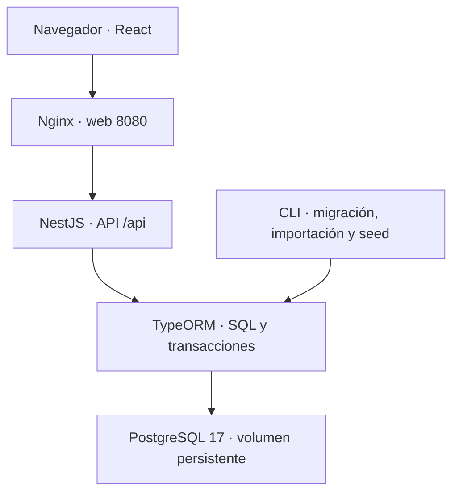

# Resolución

## Alcance

Se conserva el catálogo N1/N2, la organización Empresa → Área → Departamento → Sección → Puesto → Usuario, el importador y la autenticación local. La ampliación agrega tickets, colas y permisos, siete procesos, aprobaciones, CMDB, relaciones entre CI, 5000 dispositivos sintéticos, adjuntos, FAQ y objetivos de atención. No incluye facturación, consumo, ejecución de cambios sobre infraestructura ni provisión real de accesos externos.

## Arquitectura

El frontend se construye con React 19 y Vite 7. Nginx sirve los archivos y deriva `/api` al backend; NestJS 11 usa TypeORM 0.3 con `synchronize=false`. La API también se publica localmente en 3100. Las migraciones 001–003 crean la estructura incrementalmente. PostgreSQL conserva catálogo, usuarios, sesiones, CMDB, tickets, bitácora y bytes de adjuntos en el volumen `postgres_data`.

El catálogo usa entidades/repositorios; Service Desk usa consultas parametrizadas mediante EntityManager. El controlador recibe la petición, los guards verifican identidad/rol y el servicio aplica permisos, referencias y transiciones. FK, CHECK, índices y triggers refuerzan la integridad.

## Decisiones aplicadas

| Decisión | Comportamiento y razón |
|---|---|
| Compatibilidad de roles | `usuario.rol` mantiene administrador/consulta. `usuario_rol` agrega solicitante/agente/aprobador; las facultades operativas requieren rol explícito y permiso de cola. |
| Autenticación local | Bcrypt con sal y costo 12; JWT con jti y sesión persistente revocable. La identidad y los roles actuales se leen de DB. No se devuelven hashes. |
| Sesión al recargar | sessionStorage guarda solo token temporal y vencimiento; `/auth/me` valida antes de restaurar. No se guarda contraseña ni se prolonga el JWT. |
| Portal restringido | Solicitante sin funciones operativas: solo casos propios, creación mínima, comentarios públicos, adjuntos autorizados y ayuda. También se deniega el acceso directo a módulos internos en servidor. |
| Datos derivados | Empresa de usuario deriva de su jerarquía; N1 de ticket deriva del N2; proceso y tipo derivan de su cola. Se evitan referencias contradictorias. |
| Toma atómica | Transacción, bloqueo asesor y UPDATE condicionado a responsable NULL. Dos agentes no pueden reclamar simultáneamente el mismo ticket. |
| Transferencia y escalamiento | Conservan el proceso; exigen motivo. Escalar requiere un nivel mayor. Crear un problema desde un incidente implica otro ticket vinculado. |
| Bajas lógicas | Se bloquea la desactivación con dependencias activas; deben resolverse o reasignarse primero. Sin eliminación silenciosa. |
| CI opcional en trámite | Si no corresponde un CI, se exige una justificación. No se crean dispositivos ficticios. |
| Importación repetible | Snapshot de la última proyección importada y control de edición manual. Conserva correcciones y responsables, reporta incidencias y mantiene 12/46. |
| CI reproducibles | SHA-256 por semilla e índice, códigos únicos y ON CONFLICT DO NOTHING. Cada conjunto queda identificado. |
| Adjuntos y auditoría | PDF/PNG/JPEG/TXT hasta 2 MiB; verificación de firma donde corresponde, descarga autorizada, attachment/nosniff. Bitácora append-only mediante trigger. |
| Presentación | Ficha lateral con secciones, responsable visible y acciones de atención accesibles. Los campos pendientes se conservan al cambiar de sección, no al recargar/cerrar. |
| Build frontend | Transformación JSX con esbuild y tree shaking desactivado tras un bloqueo observado en el build. La compilación pasó; se acepta el costo potencial de un bundle mayor. |

## Tratamiento del catálogo original

Las combinaciones se resuelven únicamente dentro de su rango. Se agrupa por código, no por fila física. `SE.12` usa el primer nombre no vacío de B99, «Suministrar Analitica»; B100 «Mantener Tableros de Control» se conserva como evidencia de conflicto. Los códigos SE.12.1–SE.12.3 permanecen como texto. Los atributos ausentes de filas 99–101 se conservan desconocidos y pendientes de revisión. Las filas 42 y 67, sin código y fuera de combinaciones aplicables, se reportan sin asignarlas al registro anterior. La relación de SE.12.3 con SE.12 se deriva del prefijo, dejando trazabilidad. No se convierten umbrales ausentes en cero.

Organización, asignaciones, colas y usuarios DEMO son datos nuevos. No se atribuyen al Excel. El modelo, las fuentes y sus diferencias están en [MODELO.md](MODELO.md).

## Limitaciones comprobables

- CMDB.xlsx contiene dos ejemplos y Hardware/Software; no aporta un árbol completo. Las subclases Servidores, Estaciones de trabajo y Redes son propuesta del proyecto. La fidelidad a una taxonomía docente adicional queda pendiente de confirmación; no se declara P04 completamente satisfecho.
- Los tests automatizados ejecutados usan Node/PGlite y DOM simulado. No se ejecutaron aquí Docker, harness live ni reinicio P18. Las capturas del usuario confirman interacciones concretas, no reemplazan esas pruebas.
- El selector CI del solicitante filtra por `ci.responsable_id`. El seed asigna los CI al administrador; para pruebas propias hay que reasignar un CI desde la CMDB. No existe todavía una separación entre responsable técnico y usuario al que se entrega el dispositivo.
- Los atributos técnicos se editan como JSON administrativo. Las relaciones son navegables, sin editor gráfico. Notificaciones dentro de la aplicación, sin correo real.
- Objetivos calculados con tiempo calendario 24x7. No hay calendario hábil ni asignación/escalamiento automáticos. Duración I0–I6 no es un SLA.
- Los commits documentados corresponden al historial local de construcción. Aplicar parches en otro repositorio produce commits diferentes; no se inventan enlaces GitHub.

Ver [IA.md](IA.md) para decisiones enlazadas a cambios y [PRUEBAS.md](PRUEBAS.md) para resultados reales.
