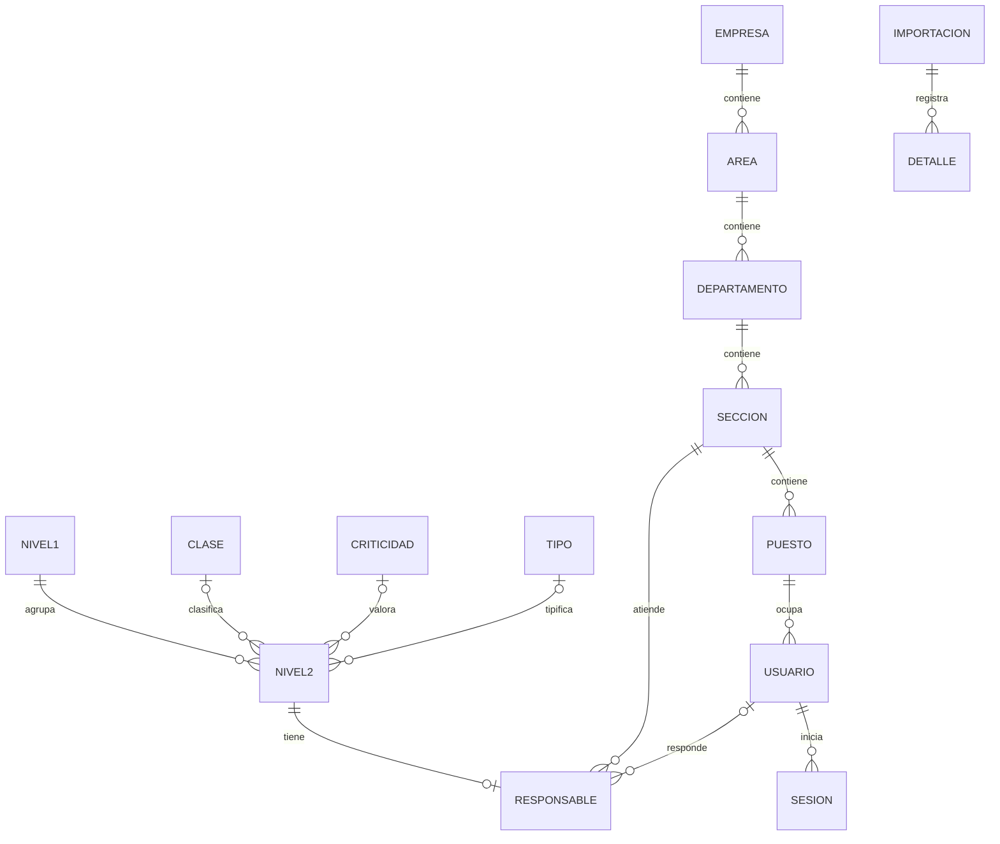

> Documento histórico del parcial conservado. La ampliación actual se describe en [MODELO_SERVICE_DESK.md](MODELO_SERVICE_DESK.md).

# Modelo y diccionario PostgreSQL / TypeORM

Entidades: `backend/src/db/entities.ts`. DDL: migraciones 001 y 002; nunca synchronize.
Esquema `catalogo`. PK BIGINT identity se expone como texto; los campos NUMERIC también,
para evitar pérdida de precisión en JavaScript. `NULL` significa información ausente.
FK siempre RESTRICT, sin borrado en cascada.

## Empresa (`empresa`)

| Campo  | Tipo                   | Llave  | Obligatorio / nulo    |
| ------ | ---------------------- | ------ | --------------------- |
| id     | BIGINT IDENTITY ALWAYS | PK     | Obligatorio, generado |
| codigo | VARCHAR(50)            | UNIQUE | Obligatorio           |
| nombre | TEXT                   | —      | Obligatorio           |
| activo | BOOLEAN                | —      | Obligatorio           |

## Área (`area`)

| Campo      | Tipo                   | Llave                     | Obligatorio / nulo    |
| ---------- | ---------------------- | ------------------------- | --------------------- |
| id         | BIGINT IDENTITY ALWAYS | PK                        | Obligatorio, generado |
| empresa_id | BIGINT                 | FK empresa.id             | Obligatorio           |
| codigo     | VARCHAR(50)            | UNIQUE(empresa_id,codigo) | Obligatorio           |
| nombre     | TEXT                   | —                         | Obligatorio           |
| activo     | BOOLEAN                | —                         | Obligatorio           |

## Departamento (`departamento`)

| Campo   | Tipo                   | Llave                  | Obligatorio / nulo    |
| ------- | ---------------------- | ---------------------- | --------------------- |
| id      | BIGINT IDENTITY ALWAYS | PK                     | Obligatorio, generado |
| area_id | BIGINT                 | FK area.id             | Obligatorio           |
| codigo  | VARCHAR(50)            | UNIQUE(area_id,codigo) | Obligatorio           |
| nombre  | TEXT                   | —                      | Obligatorio           |
| activo  | BOOLEAN                | —                      | Obligatorio           |

## Sección (`seccion`)

| Campo           | Tipo                   | Llave                          | Obligatorio / nulo    |
| --------------- | ---------------------- | ------------------------------ | --------------------- |
| id              | BIGINT IDENTITY ALWAYS | PK                             | Obligatorio, generado |
| departamento_id | BIGINT                 | FK departamento.id             | Obligatorio           |
| codigo          | VARCHAR(50)            | UNIQUE(departamento_id,codigo) | Obligatorio           |
| nombre          | TEXT                   | —                              | Obligatorio           |
| activo          | BOOLEAN                | —                              | Obligatorio           |

## Puesto (`puesto`)

| Campo      | Tipo                   | Llave                     | Obligatorio / nulo    |
| ---------- | ---------------------- | ------------------------- | --------------------- |
| id         | BIGINT IDENTITY ALWAYS | PK                        | Obligatorio, generado |
| seccion_id | BIGINT                 | FK seccion.id             | Obligatorio           |
| codigo     | VARCHAR(50)            | UNIQUE(seccion_id,codigo) | Obligatorio           |
| nombre     | TEXT                   | —                         | Obligatorio           |
| activo     | BOOLEAN                | —                         | Obligatorio           |

## Usuario (`usuario`)

| Campo          | Tipo                   | Llave                          | Obligatorio / nulo        |
| -------------- | ---------------------- | ------------------------------ | ------------------------- |
| id             | BIGINT IDENTITY ALWAYS | PK                             | Obligatorio, generado     |
| puesto_id      | BIGINT                 | FK puesto.id                   | Obligatorio               |
| nombre         | TEXT                   | —                              | Obligatorio               |
| nombre_usuario | VARCHAR(100)           | UNIQUE lower(nombre_usuario)   | Obligatorio               |
| correo         | TEXT                   | UNIQUE lower(correo), parcial  | Nulo permitido            |
| password_hash  | TEXT                   | —                              | Obligatorio; select:false |
| rol            | VARCHAR(20)            | CHECK administrador / consulta | Obligatorio               |
| activo         | BOOLEAN                | —                              | Obligatorio               |

Usuario/correo se normalizan a minúsculas. La empresa se obtiene mediante su puesto y
jerarquía; no hay una segunda FK empresa_id que permita contradicciones.

## Clase (`clase_servicio`)

| Campo  | Tipo                   | Llave  | Obligatorio / nulo    |
| ------ | ---------------------- | ------ | --------------------- |
| id     | BIGINT IDENTITY ALWAYS | PK     | Obligatorio, generado |
| nombre | TEXT                   | UNIQUE | Obligatorio           |
| activo | BOOLEAN                | —      | Obligatorio           |

## Criticidad (`criticidad`)

| Campo  | Tipo                   | Llave  | Obligatorio / nulo    |
| ------ | ---------------------- | ------ | --------------------- |
| id     | BIGINT IDENTITY ALWAYS | PK     | Obligatorio, generado |
| nombre | TEXT                   | UNIQUE | Obligatorio           |
| activo | BOOLEAN                | —      | Obligatorio           |

## Tipo (`tipo_servicio`)

| Campo  | Tipo                   | Llave  | Obligatorio / nulo    |
| ------ | ---------------------- | ------ | --------------------- |
| id     | BIGINT IDENTITY ALWAYS | PK     | Obligatorio, generado |
| nombre | TEXT                   | UNIQUE | Obligatorio           |
| activo | BOOLEAN                | —      | Obligatorio           |

El estado de opciones es disponibilidad administrativa explícita. No se hereda de ACTIVO
ni se asigna como estado a servicios. Una opción inactiva sigue visible en registros históricos;
no se permiten asociaciones nuevas con ella.

## Servicio Nivel 1 (`servicio_nivel1`)

| Campo             | Tipo                   | Llave  | Obligatorio / nulo    |
| ----------------- | ---------------------- | ------ | --------------------- |
| id                | BIGINT IDENTITY ALWAYS | PK     | Obligatorio, generado |
| codigo            | VARCHAR(20)            | UNIQUE | Obligatorio           |
| nombre            | TEXT                   | —      | Obligatorio           |
| activo            | BOOLEAN                | —      | Nulo permitido        |
| requiere_revision | BOOLEAN                | —      | Obligatorio           |

## Servicio Nivel 2 (`servicio_nivel2`)

| Campo             | Tipo                   | Llave                  | Obligatorio / nulo    |
| ----------------- | ---------------------- | ---------------------- | --------------------- |
| id                | BIGINT IDENTITY ALWAYS | PK                     | Obligatorio, generado |
| nivel1_id         | BIGINT                 | FK servicio_nivel1.id  | Obligatorio           |
| codigo            | VARCHAR(20)            | UNIQUE                 | Obligatorio           |
| nombre            | TEXT                   | —                      | Obligatorio           |
| activo            | BOOLEAN                | —                      | Nulo permitido        |
| clase_id          | BIGINT                 | FK clase_servicio.id   | Nulo permitido        |
| criticidad_id     | BIGINT                 | FK criticidad.id       | Nulo permitido        |
| tipo_id           | BIGINT                 | FK tipo_servicio.id    | Nulo permitido        |
| descripcion       | TEXT                   | —                      | Nulo permitido        |
| metrica           | TEXT                   | —                      | Nulo permitido        |
| minimo            | NUMERIC                | CHECK umbrales_validos | Nulo permitido        |
| maximo            | NUMERIC                | CHECK umbrales_validos | Nulo permitido        |
| requiere_revision | BOOLEAN                | —                      | Obligatorio           |

CHECK: `minimo IS NULL OR maximo IS NULL OR minimo <= maximo`, también validado en DTO
y servicio al combinar PATCH. No usar parseFloat ni `valor || 0`.
ACTIVO pertenece a N2, nunca se propaga automáticamente a N1. Padre N1 explícitamente
inactivo no permite nuevas asociaciones ni reactivar hijos mediante el CRUD.

## Responsabilidad (`servicio_responsable`)

| Campo              | Tipo   | Llave                      | Obligatorio / nulo |
| ------------------ | ------ | -------------------------- | ------------------ |
| servicio_nivel2_id | BIGINT | PK / FK servicio_nivel2.id | Obligatorio        |
| seccion_id         | BIGINT | FK seccion.id              | Obligatorio        |
| usuario_id         | BIGINT | FK usuario.id              | Nulo permitido     |

Cero o una asignación por servicio. Sección obligatoria en cada asignación; usuario de la misma
sección, activo. Un POST manual de N2 requiere sección y crea ambas filas en una transacción.
Excepción del enunciado: un servicio importado puede carecer de asignación; no se inventa.

## Sesión (`sesion`)

| Campo       | Tipo        | Llave                       | Obligatorio / nulo |
| ----------- | ----------- | --------------------------- | ------------------ |
| id          | UUID        | PK; jti del JWT             | Obligatorio        |
| usuario_id  | BIGINT      | FK usuario.id               | Obligatorio        |
| creada_en   | TIMESTAMPTZ | DEFAULT now()               | Obligatorio        |
| expira_en   | TIMESTAMPTZ | CHECK expira_en > creada_en | Obligatorio        |
| revocada_en | TIMESTAMPTZ | —                           | Nulo permitido     |

## Lote de importación (`importacion`)

| Campo          | Tipo                   | Llave         | Obligatorio / nulo    |
| -------------- | ---------------------- | ------------- | --------------------- |
| id             | BIGINT IDENTITY ALWAYS | PK            | Obligatorio, generado |
| archivo_nombre | TEXT                   | —             | Obligatorio           |
| archivo_sha256 | CHAR(64)               | —             | Obligatorio           |
| fecha          | TIMESTAMPTZ            | DEFAULT now() | Obligatorio           |
| version_reglas | VARCHAR(50)            | —             | Obligatorio           |
| estado         | VARCHAR(20)            | —             | Obligatorio           |
| resumen        | JSONB                  | —             | Obligatorio           |

## Detalle de importación (`importacion_detalle`)

| Campo            | Tipo                   | Llave                 | Obligatorio / nulo    |
| ---------------- | ---------------------- | --------------------- | --------------------- |
| id               | BIGINT IDENTITY ALWAYS | PK                    | Obligatorio, generado |
| importacion_id   | BIGINT                 | FK importacion.id     | Obligatorio           |
| hoja             | TEXT                   | —                     | Obligatorio           |
| fila             | INTEGER                | CHECK >0              | Obligatorio           |
| nivel1_id        | BIGINT                 | FK servicio_nivel1.id | Nulo permitido        |
| nivel2_id        | BIGINT                 | FK servicio_nivel2.id | Nulo permitido        |
| datos_originales | JSONB                  | —                     | Obligatorio           |
| datos_resueltos  | JSONB                  | —                     | Obligatorio           |
| origen_celdas    | JSONB                  | —                     | Obligatorio           |
| resultado        | VARCHAR(20)            | —                     | Obligatorio           |
| observaciones    | JSONB                  | —                     | Obligatorio           |

Celda subordinada de combinación: original NULL y referencia al master; resuelto contiene
el valor de su master. No se confunde ese original con un valor realmente vacío del master.
El binario original y su SHA permiten reconstruir cualquier evidencia.

## Proyección importada (`importacion_snapshot`)

| Campo               | Tipo        | Llave                             | Obligatorio / nulo |
| ------------------- | ----------- | --------------------------------- | ------------------ |
| entidad             | VARCHAR(20) | PK compuesto; CHECK nivel1/nivel2 | Obligatorio        |
| codigo              | VARCHAR(20) | PK compuesto                      | Obligatorio        |
| payload             | JSONB       | Última proyección importada       | Obligatorio        |
| editado_manualmente | BOOLEAN     | DEFAULT false                     | Obligatorio        |

No representa una segunda identidad del servicio. Controla reconciliación por código y
no contiene responsables. Los códigos importados no se cambian por CRUD.

## Marca de migración (`schema_migration`)

| Campo       | Tipo        | Llave         | Obligatorio / nulo |
| ----------- | ----------- | ------------- | ------------------ |
| version     | TEXT        | PK            | Obligatorio        |
| aplicado_en | TIMESTAMPTZ | DEFAULT now() | Obligatorio        |

## Política de integridad

Bajas lógicas; bloquear unidades con descendientes activos o asignaciones; bloquear traslado
de usuarios/puestos que invalide su sección responsable; bloquear baja de N1 con hijos activos.
El CRUD y las cargas se serializan con bloqueo asesor transaccional. Los triggers y las FK
refuerzan las reglas para accesos SQL. La base no exige asignación a todos los N2 por la
excepción de importación; esa obligatoriedad del alta manual se valida en la API.

## Mapeo de etiquetas (`opcion_mapeo`)

| Campo         | Tipo        | Llave                                         | Obligatorio / nulo              |
| ------------- | ----------- | --------------------------------------------- | ------------------------------- |
| entidad       | VARCHAR(20) | PK compuesto; CHECK clases/criticidades/tipos | Obligatorio                     |
| nombre_origen | TEXT        | PK compuesto                                  | Obligatorio                     |
| clase_id      | BIGINT      | FK clase_servicio.id                          | Nulo salvo entidad=clases       |
| criticidad_id | BIGINT      | FK criticidad.id                              | Nulo salvo entidad=criticidades |
| tipo_id       | BIGINT      | FK tipo_servicio.id                           | Nulo salvo entidad=tipos        |
| fecha         | TIMESTAMPTZ | DEFAULT now()                                 | Obligatorio                     |

CHECK: exactamente una FK no nula, correspondiente a entidad. Al renombrar opciones se
conserva el nombre anterior, con fecha y referencia a la identidad actual. No se sobreescribe
el Excel. El importador reconoce ese alias, preserva IDs y reporta el mapeo. Un alias queda
reservado para su identidad y no se reutiliza para otra. Lectura administrativa en catalog/mapeos.
