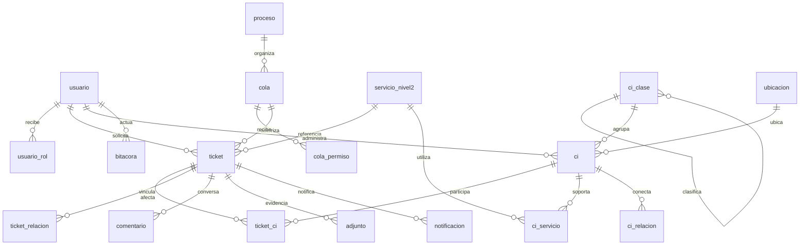
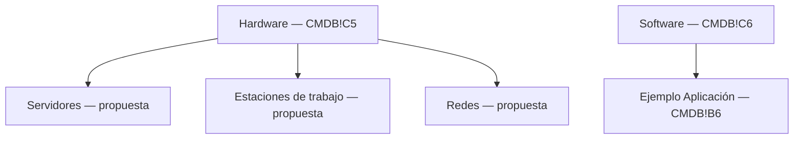

# Modelo ampliado y mapeo de fuentes

El modelo anterior se conserva en MODELO.md. Migración aditiva 003_service_desk.sql. Identificadores BIGINT, expuestos como texto para evitar pérdida de precisión JS. synchronize=false. No se repiten N1, tipo ni empresa dentro de tickets: se derivan de sus relaciones.

## Diccionario de tablas nuevas

| Tabla | Datos principales / restricciones |
|---|---|
| usuario_rol | PK usuario+rol. Roles adicionales; el rol base sigue en usuario. |
| proceso | Siete códigos controlados, nombre y tipo de ticket. |
| cola | Código único, descripción, activo, FK proceso y responsable, nivel 0–4, orden, objetivos positivos en minutos. |
| cola_permiso | FK cola y usuario o rol, nunca ambos; array de permisos enumerados. |
| ubicacion | Nombre único, estado. Baja protegida desde API ante CI activos. |
| ci_clase | Código único, nombre, padre opcional, estado y origen. FK y trigger anticiclo. |
| ci | Código único, nombre, clasificación, estado lógico/operativo, ubicación, responsable, es_dispositivo, atributos JSONB, fuente JSONB, conjunto sintético, actualización. |
| ci_relacion | PK origen+destino+tipo. Prohíbe autoarista. Tipos: depende_de/alojado_en/conectado_a. |
| ci_servicio | PK CI+N2. Relación muchos a muchos. |
| ticket | Título, descripción, solicitante, creador, servicio, cola, responsable opcional, estado, prioridad 1–3, impacto, urgencia, canal, motivo sin CI, detalle por proceso, resolución, fechas, pausas, evento origen único, clave externa única y clave demo única. |
| ticket_ci | PK ticket+CI. Sin filas exige motivo en ticket. |
| ticket_relacion | Origen+destino+tipo; relacionado/causa/corrige/duplicado/origina. |
| bitacora | Entidad, registro, actor, fecha, acción, anterior/nuevo JSONB y motivo. Trigger rechaza UPDATE/DELETE. |
| comentario | Ticket, actor, texto, interno, fecha. Notas internas protegidas. |
| adjunto | Ticket, actor, nombre, MIME, bytes ≤2 MiB, interno, fecha. Se almacena en DB, no ruta pública. |
| notificacion | Ticket, mensaje, fecha. Canal verificable dentro de aplicación. |
| faq | Título, contenido, estado lógico. |

JSONB de ticket guarda atributos específicos de cada proceso, incluyendo aprobador y fecha generados exclusivamente por la transición autorizada. No son campos editables libremente. La bitácora conserva snapshots de cada acción relevante, comentarios/adjuntos tienen auditoría propia sin filtrar su contenido a la bitácora visible del solicitante.

## Clasificación de CMDB

El último nodo Aplicación es un CI, no una categoría nueva. Los 5000 dispositivos se distribuyen entre las tres subcategorías Hardware según SHA-256(semilla:índice). Software se conserva como clase del ejemplo y no se cuenta como dispositivo físico. Este árbol extendido es una decisión del proyecto: el Excel no contiene jerarquía en J5/J6 y Transicion.pptx.pdf no enumera categorías de dispositivos. No se puede acreditar coincidencia con una taxonomía docente distinta que no fue aportada. La estructura es editable para incorporar la aclaración sin sustituirla por la jerarquía organizacional.

## Excel CMDB → modelo

| Celda encabezado | Campo original | Destino |
|---|---|---|
| B4 | Nombre del CI | ci.nombre |
| C4 | Tipo de CI | ci_clase; Hardware/Software de C5/C6 |
| D4 | Descripción | atributos.descripcion |
| E4 | Número de Serie | atributos.numero_serie; espacio vacío→NULL |
| F4 | Versión | atributos.version |
| G4 | Fecha de Adquisición | atributos.fecha_adquisicion; texto ISO original preservado |
| H4 | Estado Actual | ci.estado; se conserva texto original en fuente |
| I4 | Relaciones | atributos.relaciones_originales; referencia Base de Datos1 pendiente |
| J4 | Padres/Hijos | atributos.padres_hijos; valores vacíos no inventados |
| K4 | Ubicación Física | atributos.ubicacion_original y fuente; ubicación operativa demo separada |
| L4 | Propietario/Responsable | atributos.responsable_original; usuario operativo demo separado |
| M4 | Fecha de Cambio | atributos.fecha_cambio |
| N4 | Descripción del Cambio | atributos.descripcion_cambio |
| O4 | Documentación relacionada | atributos.documentacion |
| P4 | Enlaces a Incidentes y Problemas | atributos.enlaces_incidentes; enlaces de ejemplo no ejecutados |
| Q4 | Niveles de Seguridad | atributos.seguridad |
| R4 | Cumplimiento | atributos.cumplimiento |
| S4 | Estado de Configuraci√≥n | atributos.estado_configuracion; mapeo de etiqueta explícito |
| T4 | N√∫mero de Licencia | atributos.licencia; mapeo de etiqueta explícito |
| U4 | Fecha de Vencimiento | atributos.vencimiento |

Cada ejemplo conserva 20 encabezados/valores originales, archivo, SHA-256, hoja y rango en fuente. Su ubicación/responsable operativo se asigna como DEMO porque las cadenas originales no identifican usuarios locales ni referencias normalizadas. La ubicación 'Servidor1' de la aplicación se conserva textual; no se convierte automáticamente en relación técnica. Base de Datos1 no se inventa. Documentación con codificación dañada también permanece en fuente.

Campos nuevos: codigo, IDs/FKs normalizadas, es_dispositivo, activo lógico, conjunto, actualizado_en, relaciones tipadas, asociaciones a servicios/tickets e historial por actuación. No se presentan como columnas originales. Los atributos técnicos sintéticos ram_gb, disco_gb, puertos, modelo y sistema_operativo se distinguen por origen DEMO. No se obliga IP.

## Mapa de materiales

| Fuente | Localización | Uso |
|---|---|---|
| CatalogoServicios.xlsx | Servicios Externos A4:L101 y F112:H122 | Importador original, 12/46, incidencias SE.12 y filas sin código |
| CMDB.xlsx | CMDB B4:U6 | 20 campos y dos CI de ejemplo; origen y etiquetas preservados |
| Transicion.pptx.pdf | Diapositivas 10–12 | CI, atributos, SACM, CMS, configuración e integridad |
| Transicion.pptx.pdf | Diapositiva 14 | Relación conceptual SKMS/CMS/CMDB/KEDB, no árbol de dispositivos |
| Service Desk.pptx.pdf | Diapositiva 11 y 12–13 | Esquemas de soporte y equivalencias documentadas |
| Service Desk.pptx.pdf | Diapositiva 14 | Seis tipos, nuevos como subtipo de requisición |
| Service Desk.pptx.pdf | Diapositivas 15–16 | E0–E3 e I0–I6, agrupación visual prioridad/redundancia |
| SA_P3.pdf | Apartados 4–11 | Operaciones, siete procesos, datos demo y pruebas P01–P18 |

El enunciado original del parcial transcrito se conserva en docs/ENUNCIADO.md. Todos los archivos recibidos se conservan sin modificar en data; SHA-256 en FUENTES_SHA256.txt.

## Grafos y ciclos

Clasificación: aristas padre→hijo, un padre y sin ciclos, validados por trigger. Relaciones técnicas: origen depende_de destino o alojado_en destino; se rechazan ciclos en el conjunto de ambas. conectado_a admite ciclos técnicos. SQL recursivo con UNION elimina revisitas y garantiza terminación del recorrido, incluyendo ciclos permitidos. Impacto potencial se calcula recorriendo aristas inversas desde el CI afectado y obteniendo servicios vinculados a los dependientes. El acceso a tickets del CI vuelve a aplicar permisos por ticket.
